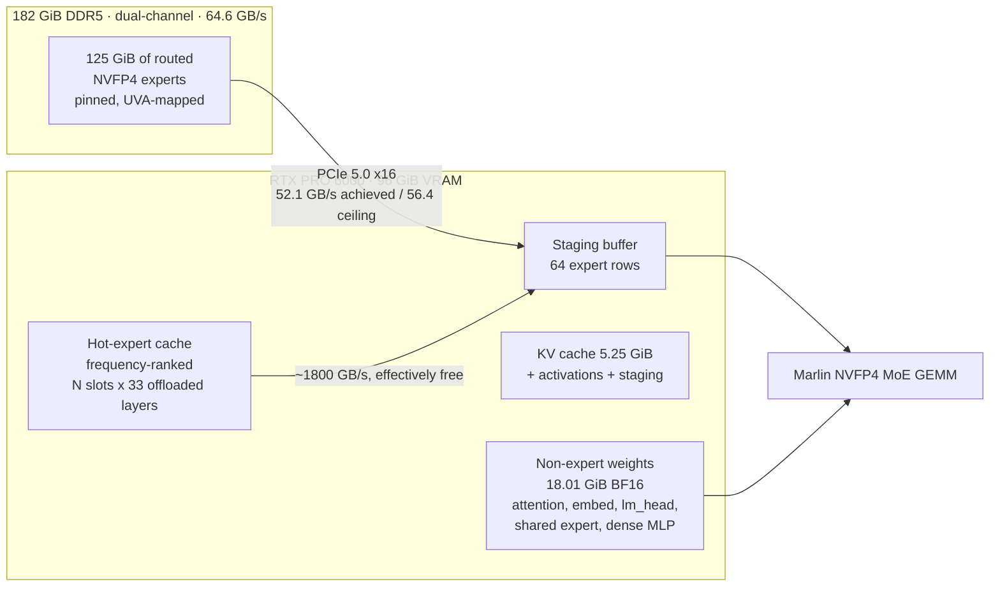
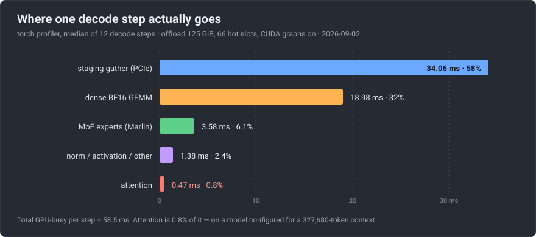
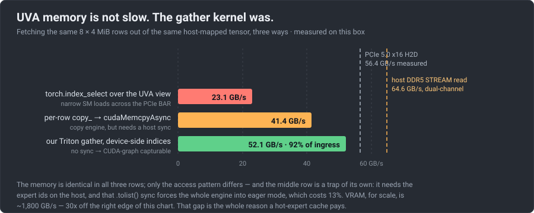
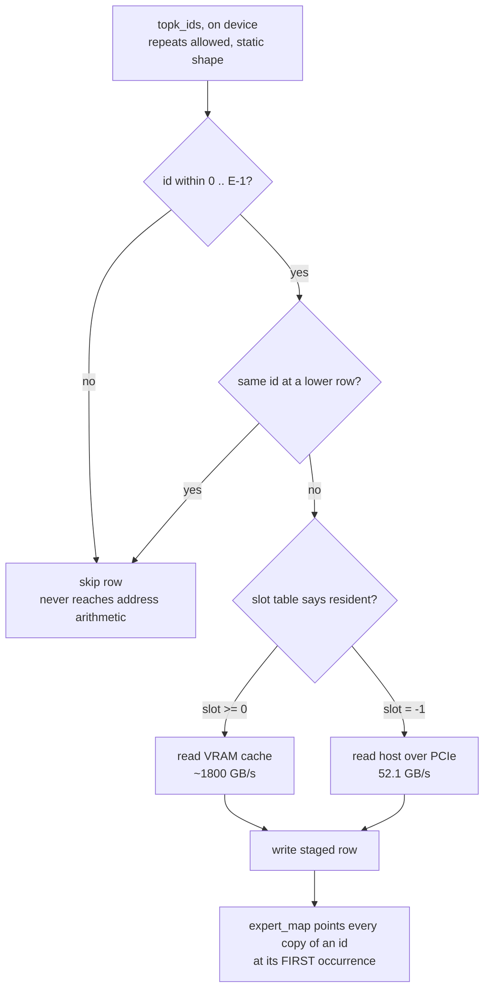
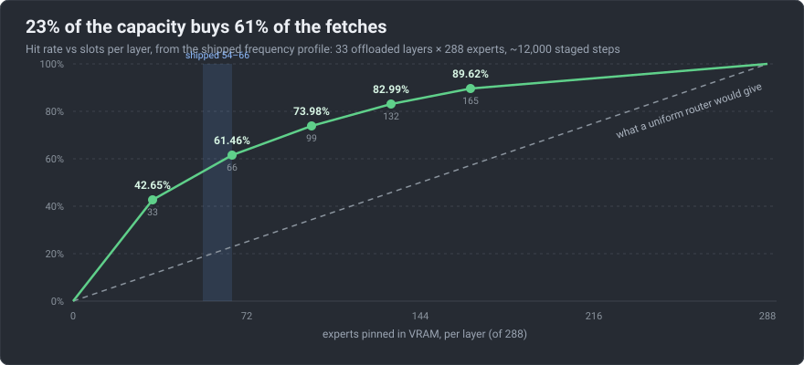
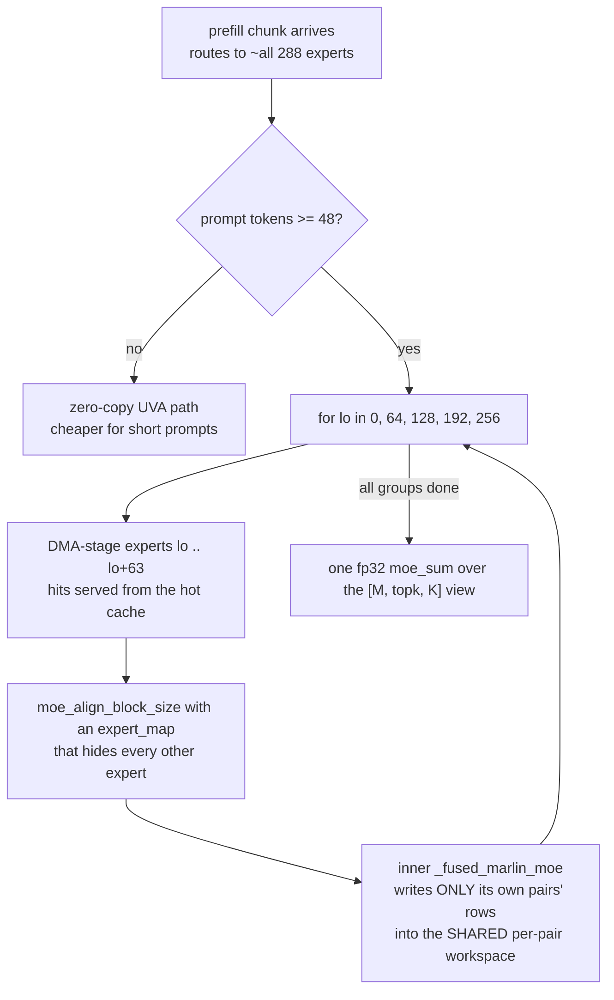
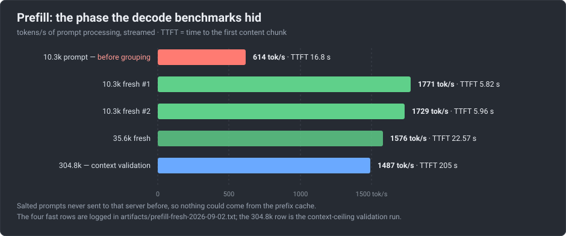
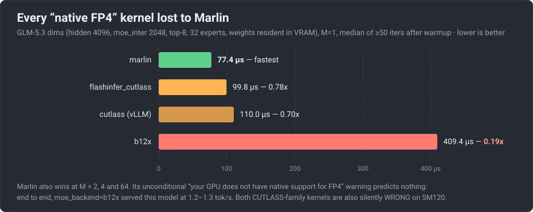

# A 181 GiB model on a 96 GiB GPU: GLM-5.3-Flash at 16.5 tok/s on one RTX PRO 6000

**320B total / 18B active, NVFP4, single card, no quality loss — and a list of the
things that didn't work, which is the more useful half.**

GLM-5.3-Flash in NVFP4 is a 181.29 GiB checkpoint. The card is a single RTX PRO
6000 Blackwell Workstation with 96 GiB of VRAM — 94.97 GiB of it visible to
torch. The model is roughly twice the size of the memory it has to run in, so
125 GiB of routed expert weights live in host DDR5 and cross PCIe on demand,
every token.

It decodes at **16.50 tok/s** and prefills at **~1750 tok/s**, and a
304,800-token prompt has been run end to end. Every number below carries the
conditions it was measured under, because on this workload almost every number
is conditional.

We are not aware of a faster published figure for this model on a single RTX PRO
6000 — though "not aware of" is doing real work in that sentence, and we would
rather be corrected than believed. The nearest comparison in our notes is a
FreeToken figure of ~14.9 tok/s for **GLM-5.2** on the same GPU, paired with a
Xeon Platinum 8559C whose host memory bandwidth is ~2.8x ours. Treat that as
second-hand: it is a different model version, we recorded it without a link, and
we have not reproduced it, so it is context rather than a scoreboard. If you have a better number on this card, we
genuinely want to see it.

---

## The result, with its conditions

| | |
|---|---|
| **Decode** | **16.50 tok/s**, sustained over 8 back-to-back 200-token generations, measured 2026-09-01 at 66 hot-expert slots per layer |
| decode on the **currently shipped** config (54 slots, traded down for long-prompt headroom — see *Long context*) | **14.99 tok/s** on the short-prompt prose benchmark (48 slots: 14.92 — the difference is inside run-to-run spread) |
| decode measured *streamed, at context* | **18.2–18.4 tok/s** at 10k and **17.5–18.4** at 35k, on the 62-slot build. Long context does not slow decode down on this stack |
| **Prefill** | **1771 / 1729 tok/s** on two fresh ~10.3k-token prompts (TTFT **5.82 s** / **5.96 s**); **1576 tok/s** on a fresh 35,571-token prompt |
| prefill *before* this work | **614 tok/s** — the same class of 10k prompt took **16.8 s** to first token |
| **Context** | `--max-model-len 327680`, **validated by actually prefilling a 304,800-token prompt** (TTFT 205 s, 1487 tok/s) |
| batch shape | `--max-num-seqs 1`, one stream, no concurrency. These are single-user latency numbers, not throughput-under-load numbers |
| speculation | MTP depth 2 — 64% of draft tokens accepted = **1.28 accepted per step**, i.e. 2.28 tokens per forward pass |
| quality | unmodified. The fast prefill path is numerically indistinguishable from the baseline's *own* run-to-run variability, measured per-token over 13,519 prompt logprobs |
| stability | 40 varied requests (T=0/0.7/1.0, four 9k prefills) plus a 35,553-token prompt: **0 failures, 0 Xid, 592 s** |
| engine | vLLM PR #53906 (`0.29.0.dev0+glm53`) + local patches, FlashInfer 0.6.18 |

**The machine.** Ubuntu 26.04 · AMD Ryzen 9 9950X3D (16c/32t) on an X870E AORUS
ELITE X3D · 182 GiB DDR5, **dual-channel** · 1× RTX PRO 6000 Blackwell (SM120)
· PCIe 5.0 x16 · driver 595.84 / CUDA 13.2 · **no swap**. A desktop, not a
server.

Measured platform bandwidths — all from this box, none from a datasheet:

```
CPU STREAM read        64.6 GB/s     <- dual-channel, NOT quad
PCIe 5.0 x16 H2D       56.4 GB/s
PCIe 5.0 x16 D2H       57.3 GB/s
our gather kernel      52.1 GB/s     <- 92% of H2D ingress
VRAM                 ~1800 GB/s      (vendor figure, not measured here)
```

That 64.6 GB/s is the most important number in the project. Host RAM is only
1.15x PCIe here, which kills every "compute the offloaded experts on the CPU
instead" design before it starts.

---

## Why this is even possible

90% of the checkpoint is routed MoE experts (163.27 GiB of 181.29), and a decode
step touches only 8 of 288 experts per layer. So the experts live in pinned host
RAM behind a UVA (zero-copy) mapping and the GPU reads what routing actually
selected — **4.43 GiB of expert weights per decoded token** (42 MoE layers × 8
experts × ~13.5 MiB), instead of the 163 GiB the layer nominally contains.



The naive version of that — let the matmul read host memory directly — runs at
**10.77 tok/s**. Getting to 16.5 took three changes. Everything else we tried,
which is a longer list, did not work.

---

## First, measure: where a decode step actually goes

Arithmetic is not a profile. A torch-profiler trace of the *optimized*
configuration, median of 12 decode steps:



Two things fall out that no amount of arithmetic would have produced.

**Attention is 0.1% of GPU time.** 0.47 ms, on a model configured for a
327,680-token context. Every instinct says the long-context attention kernel is
where the time goes. It is not, and it never was.

**The second-largest term is 18.01 GiB of BF16 weights the NVFP4 quantizer never
touched** — attention projections 11.74 GiB, shared expert 2.02, dense MLP 1.58,
embedding 1.18, lm_head 1.18. They are read every token. At ~1.8 TB/s the floor
is 10.74 ms, so that phase runs at ~57% of peak bandwidth. Nobody suspected it
until the trace said so.

> **How not to read that trace.** The captured window also contained 2 prefill
> steps at ~811 ms of CUDA time each, so the profiler's *aggregate* operator
> table is dominated by prefill: the Marlin MoE kernel shows up as the single
> largest line item at 37% of CUDA time — the exact opposite of its 3.58 ms
> share of a decode step. Decompose decode steps only. And then go read the
> prefill steps anyway: those two excluded outliers were the only visible sign
> of the biggest win of the project, and they sat in a "profiling artifact"
> bucket for a day.

---

## Idea 1 — the gather kernel: UVA memory is not slow, the *gather* is

The first instinct about zero-copy offload is that host memory is far away and
therefore slow. Measured on this box, fetching the same 8 × 4 MiB rows from the
same host-mapped tensor three different ways:



`torch.index_select` on a host-mapped tensor launches a gather kernel whose SMs
issue narrow 64–128 byte loads across the PCIe BAR, with limited outstanding
requests and no DMA engine involved. A per-row `copy_` on the *same view* lowers
to `cudaMemcpyAsync`, runs on the copy engine, and is **4.2x faster from
identical memory**.

But `copy_` needs the expert ids **on the host** to drive its loop, and
`topk_ids.tolist()` is a device-to-host sync, which CUDA graph capture forbids.
That forced `--enforce-eager` on the entire engine — and eager mode costs 13%
here (**11.77 vs 13.53 tok/s** with identical staging). On a workload where the
GPU spends most of its time waiting on PCIe, launch overhead still mattered.

So the gather is a Triton kernel that takes its indices as a **device tensor**.
No sync, so it captures cleanly, and its wide contiguous per-row access reaches
**52.1 GB/s — 92% of measured H2D ingress**, faster than the DMA path it
replaces.

One subtlety is worth the ink. `topk_ids` *repeats* experts — several of the
tokens verified in one MTP step pick the same expert — and `torch.unique` has a
data-dependent output shape, which graph capture rejects. So dedup happens
*inside* the kernel:

```python
r = tl.program_id(0)
e = tl.load(idx + r).to(tl.int64)
if (e < 0) | (e >= n_experts):     # bounds check: see "Stability"
    return
js = tl.arange(0, MAXN)
prev = tl.load(idx + js, mask=js < r, other=-1).to(tl.int64)
if tl.sum((prev == e).to(tl.int32)) > 0:
    return                          # this expert already fetched at a lower row
```



The grid stays statically shaped while only unique bytes cross PCIe. And the
staged weights plus a local `expert_map` are *exactly* the shape vLLM's existing
expert-parallelism path already produces — so **no Marlin kernel change was
required**.

**10.77 → 13.53 tok/s.**

---

## Idea 2 — hot-expert pinning, and the mistake that nearly killed it

With `cpu_offload_gb` set, vLLM makes residency a **whole-layer** decision: some
layers are entirely in VRAM, the rest entirely on the host. Which experts stay
resident is decided by module iteration order — arbitrarily. So 36% of experts
resident serves 36% of fetches, and no more.

Doing better requires routing skew. We looked for it, and concluded there was
none:

> *"GLM-5.3's expert routing is near-uniform with no locality; caching levers are
> capped at ~1.15x."*

**That was wrong, and it was wrong in an instructive way.** The histogram had
been built by summing per-expert counts *across layers*. Different layers are hot
on different experts, so that summation washes the skew out. A live aggregate
dump agreed with the wrong answer, which is why it was believed.


Measured *per layer*, the hottest ~36% of a layer's experts serve **75% of that
layer's fetches**. That is a completely different design space.

What ships is a per-layer VRAM cache of the frequency-ranked hottest experts,
plus a **device-resident slot table** the same gather kernel reads to choose its
source per row:

```python
sl = tl.load(slot + e).to(tl.int64)
if sl >= 0:
    v = tl.load(cache + sl * row_bytes + offs, mask=m, other=0)   # VRAM, ~1.8 TB/s
else:
    v = tl.load(src   + e  * row_bytes + offs, mask=m, other=0)   # PCIe, ~52 GB/s
```

The table lives on the device for the same reason the indices do: a host round
trip breaks graph capture, and eager mode would eat most of what the cache wins.
A hit is effectively free; only misses cost link time.



At 66 slots of 288, **23% of the capacity serves 61.5% of the fetches.**

The counter-intuitive consequence is that **offloading *more* made it faster**:

| configuration | tok/s |
|---|---|
| offload 105 GiB, no pinning *(the old default)* | 13.73 |
| offload 125 GiB, no pinning | **11.34** ← worst of the three |
| offload 125 GiB + 66 hot slots/layer | **16.50** |

More bytes cross PCIe at offload 125 — but the VRAM it frees funds the cache
that absorbs them. The offload and the cache are a **matched set**; change one
without the other and you lose most of the gain, in the wrong direction.

**13.53 → 16.50 tok/s.**

Two neighbouring ideas do *not* pay, and both were measured rather than
reasoned about:

- **Temporal locality / LRU.** A 16-slot-per-layer LRU over 288 experts hit
  **9.0%** (10,188 / 113,208 fetches) against 5.6% at random. GLM-5.3 activates
  8 of 288 (2.8%) — far sparser than the Mixtral-class models the caching papers
  study. Static frequency skew is the property that pays here; temporal locality
  is not.
- **Water-filling per-layer slot budgets.** Redistributing the same total slots
  toward the more skewed layers gains **+0.07 pp** of hit rate. The layers' hot
  *sets* differ but their distribution *shapes* are alike, so uniform allocation
  is already optimal. A clean negative that saved writing a solver.

---

## Idea 3 — grouped prefill: the phase the decode benchmarks hid

Everything above is a *decode* number, and for a day decode was the only thing
being measured. It hid the term that dominates an agentic coding turn: time to
the first token.

**614 tok/s. A 10,296-token prompt took 16.8 s before its first token.**

And the cause was our own optimization's guard rail. A prefill chunk routes to
essentially *all* 288 experts, so `n > MAX_STAGED_EXPERTS` (64), `stage()`
declines, and Marlin falls back to reading every offloaded expert zero-copy over
the PCIe BAR at ~23 GB/s with tile re-reads — instead of the 52 GB/s DMA gather
decode enjoys. Decode was fast *because* it touches 8 experts per layer; prefill
was slow for exactly the same reason, inverted.



The critical detail is what is *not* there: no partial sums. Every
`(token, expert)` pair belongs to exactly one group, so the groups fill disjoint
rows of one workspace and a single fp32 reduction runs at the end. A first draft
that summed five BF16 partial outputs **flipped tokens at T=0**. That is not a
stylistic preference; it is the difference between correct and not.



**614 → 1729–1771 tok/s. 10k TTFT 16.8 s → 5.82 s.** Decode at those contexts is
unaffected at 18.2–18.4 tok/s.

### The short-prompt trap, and the measurement mistake it caused

The first shipped version grouped *every* prefill — including a 14-token prompt
that only routes to ~100 experts. It staged all 288 and paid **2.05 s** to first
token, against **0.85 s** on the zero-copy path. The 200-token benchmark then
read **12.5 tok/s instead of 15.8**, and that was called a decode regression.

It was not. The decode rate itself was unchanged; the extra 2.05 s of TTFT was
being amortized into a whole-request rate. Streaming TTFT separately from the
inter-token rate showed it in one run. The same arithmetic explains a soak taken
in that window: a 150-token generation at 16.7 tok/s takes 9.0 s, and adding
2.05 s predicts 13.6 tok/s end-to-end against 13.9 measured.

> **Always separate TTFT from the inter-token rate before calling anything a
> decode regression.**

The fix is a `topk_ids.shape[0] >= 48` gate — static per captured graph, so
CUDA-graph-safe — sending short prompts back to zero-copy. The crossover is
~40 tokens.

### The correctness claim we had to withdraw

The launcher comment for this path used to say the grouped result was
*"bit-identical to the single pass (T=0 outputs identical on 3k and 10k
prompts)"*. **That test proves nothing, and the claim was withdrawn.**

Baseline prefill on this stack, with no code change at all, produces different
output run to run: the same 3k and 9k prompts at T=0 hashed A, B, A across three
runs of the *unmodified* build. The pattern matches prefix-cache state reuse —
mamba `align` mode caches state at scheduler-step boundaries, a continuation from
cached state rounds differently in BF16, and a knife-edge argmax flips. Two lucky
draws produced "identical" and were briefly believed. Worse, a *different*
optimization was wrongly blamed and removed for "nondeterminism" that the
baseline has as well.

The valid test compares **per-token prompt logprobs on fresh prompts**, and
measures the candidate against the baseline's *own* fresh-vs-cached drift:

| comparison | tokens | p50 | p90 | p99 | \|Δ\| > 1 nat |
|---|---|---|---|---|---|
| baseline vs itself (fresh vs cached), 3k | 3,219 | 0.000006 | 0.00054 | 0.057 | 6 (0.19%) |
| baseline vs itself (fresh vs cached), 9k | 10,300 | 0.000011 | 0.00013 | 0.0065 | 5 (0.05%) |
| **grouped vs baseline**, 3k | 3,219 | 0.000008 | 0.00069 | 0.075 | 4 (0.12%) |
| **grouped vs baseline**, 9k | 10,300 | 0.000012 | 0.00022 | 0.014 | 7 (0.07%) |

The honest statement is therefore: **grouped prefill is numerically
indistinguishable from the baseline's own run-to-run variability** — not that it
is bit-identical. If your stack is nondeterministic, an equivalence test has to
be calibrated against that nondeterminism, or it is measuring nothing.

---

## The negative results, which are most of the work



**Every "native FP4" MoE kernel lost to Marlin.** Marlin logs *"your GPU does not
have native support for FP4"* on every launch, which reads like an obvious lead:
find the kernel that uses Blackwell's FP4 tensor cores properly and win. At
GLM-5.3 dims with weights resident in VRAM, M=1, median of ≥50 iterations:
**marlin 77.4 µs**, flashinfer_cutlass 99.8 (0.78x), vLLM cutlass 110.0 (0.70x),
b12x 409.4 (**0.19x**). Marlin wins at M = 1, 2, 4 and 64. End to end,
`moe_backend=b12x` served this model at **1.2–1.3 tok/s**. The warning is
unconditional in the Marlin path and predicts nothing. Both CUTLASS-family
kernels are additionally *silently wrong* on SM120 — they accept the work and
return garbage, and the model emits one token forever with no error.

The rest, condensed:

| idea | verdict |
|---|---|
| **CPU co-execution** (compute cold experts on the host) | Measured **0.895x** — a regression. Host RAM is 1.04x PCIe bandwidth for this access pattern; FreeToken's own policy needs 2.0x before it will select its hybrid backend. This is a *platform* result: dual-channel desktop DDR5, not a design flaw |
| **GPUDirect Storage / NVMe as an additive path** | The topology is ideal — GPU and NVMe on separate CPU root ports — and it still dies. Both paths converge on the GPU's x16 ingress, and we are already at 92% of it. 4.3 GB/s of headroom for any additional source. `nvidia-fs` isn't even installed |
| **Bigger LRU expert cache** | 9.0% hit rate against 5.6% at random |
| **Water-filling per-layer slot budgets** | +0.07 pp |
| **Deeper speculation** | MTP depth 5 exceeds the KV cap at startup; depth 4 trips a DeepGEMM `block_kv` assert in the sparse-attention indexer on arch 12. At depth 2, a free n-gram drafter could only save the one MTP layer (~2–3% of a step) |
| **Re-profiling the hot set on mixed-temperature traffic** | Worse on *everything*: prose 13.02 vs 15.77, coding 16.10 vs 17.10, prefill 1698 vs 1762 — for +4 GiB of VRAM margin. Sampling at T>0 randomizes tokens and flattens the routing skew the profile exists to capture. Capture at T=0 on your real workload |
| **Raising `--gpu-memory-utilization`** | 0.95 and 0.96 give byte-identical VRAM and the same 272,771-token KV cache. Buys nothing when `KV_BYTES` is explicit and weights + cache are fixed |
| **The native SM120 sparse-MLA attention backend** | Refuses this model at startup: it expects DeepSeek's `qk_rope_head_dim=64` / 576-wide query, and GLM-5.3 is NoPE MLA. We run the SM90 kernel on Blackwell by fallback |
| **Shrinking `--max-num-batched-tokens` for VRAM headroom** | 4096 kills the engine on the first request, re-tested after the stability fix below. A real floor, and it closes the obvious route to long-context headroom |

And one methodological trap worth naming: a hot-expert histogram captured with
grouped prefill enabled carries a **uniform +1 bias per expert per chunk**.
Ranking survives it, but raw top-k shares read ~17% low. Subtract the per-layer
minimum before estimating hit rates from such a profile.

---

## Two levers we can reach and will not pull

**Router pruning.** GLM routes top-8; fetching only the 6 highest-weighted
experts cuts PCIe traffic and measures **20.48 tok/s against 16.50 — +24%**. It
is implemented, it selects by weight (not by slicing `[:, :k]` — the router's
output order is not guaranteed sorted) and renormalizes, and its static output
shape keeps CUDA graphs capturing. **It is off by default and stays off**, because
output visibly degrades: repetition loops (*"Jupiter (planet) (planet)
(planet)"*) and explanations drifting into word salad. Simple facts survived
(Paris; 17×23=391), which is exactly what makes it dangerous — it looks fine on a
spot check. This deployment is used for work where a hallucination is expensive.

**FP8 for the 18.01 GiB of BF16 dense weights.** The profiler says that is
18.98 ms of every step; halving those bytes is worth ~5–6 ms/token. Three
findings bound it:

1. *"FP8 is free because FP8 is the native checkpoint format"* is **refuted by
   direct measurement on our own tensors**. The BF16 dense tensors are not
   FP8-representable — round-tripping through e4m3 has non-zero error — so they
   are genuine BF16 masters. Properly scaled FP8, per-tensor *and* per-channel,
   gives **~31 dB SNR**: the expected figure for e4m3's three mantissa bits. A
   real, if mild, loss.
2. **No pre-quantized checkpoint fits.** A full-FP8 GLM-5.3-Flash is ~331 GB
   against 182 GiB host + 96 GiB VRAM ≈ 278 GB. It cannot fit at all.
3. **No mixed variant exists** — every published NVFP4 build has the same layout
   as ours: NVFP4 experts, everything else BF16.

**So the quality-neutral ceiling on this hardware is ~16–17 tok/s.** Reaching 25
requires stacking both of the above, and both change model outputs.

---

## Stability: an intermittent MMU fault

The engine used to die mid-serving with `CUDA error: an illegal memory access`,
and an earlier version of our own notes blamed `--max-num-batched-tokens` below
8192 for it. That attribution was wrong: the same fault hit a run at 8192 after
12 requests. Smaller batch sizes only changed the allocation layout so the
corruption surfaced on request 2 instead of request 12.

(Confusingly, both things turned out to be true: the *crash attribution* was
wrong, and yet re-testing after the fix below showed `--max-num-batched-tokens
4096` still kills the engine on the first request, for a reason we have not root
caused. 8192 is a real floor. It is just not what was causing the Xid.)

The kernel log names it: `Xid 31 ... MMU Fault`. The Python traceback pointed at
the FlashInfer sparse-MLA backend, but CUDA's own message warns that such errors
are *reported asynchronously at some later call* — a stack tells you where the
error was noticed, not where it was caused.

Two changes were made, and the pair holds:

1. **Bounds-check every id-indexed access in the staging path** — both Triton
   gather kernels, `build_local_expert_map`'s `scatter_reduce_`, and the Marlin
   call site. A padded or sentinel expert id (`-1`, or `n_experts`) would index
   past the host tensor, or read garbage past the slot table and then
   *dereference that garbage* — which is precisely an unmapped address.
2. **`VLLM_USE_BREAKABLE_CUDAGRAPH=0`.** vLLM auto-enables "breakable" CUDA
   graphs for this hybrid model. Every build that ran under breakable graphs on
   2026-09-02 faulted between request 2 and request 24. With it off, two
   40-request soaks ran with **0 failures and 0 Xid at unchanged speed**.

**The mechanism is not proven.** The profiler had shown kernels overlapping
across streams while the staging buffers are shared, which is consistent with a
race that breakable mode makes possible — but that is a hypothesis, not a proof.
Treat it as a measured fix with an unproven cause, and note that it has not been
exercised for days of continuous serving.

This also resolved a symptom that looked nothing like a crash: agent sessions
that "forgot everything" and re-ran their first tool call in a loop. 83 of 86
agent requests returned 200; the 3 failures were engine deaths, and a dead turn
leaves an empty assistant message that the chat template renders as a fresh
thread. **Verify the server before blaming the client.**

---

## Long context: the ceiling is free VRAM, not `--max-model-len`

Raising `--max-model-len` from 262,144 to 327,680 is not enough on its own.
Long-prompt activations — attention plus the sparse indexer — are allocated per
request and are *not* reserved up front, so the usable ceiling is set by **free
VRAM**, not by the advertised context:

```
60 hot slots -> 3,397 MiB free -> a 180k-token prompt dies
                ("CUDA out of memory. Tried to allocate 116.00 MiB")
54 hot slots -> 6,177 MiB free -> 304,800 tokens prefill fine (TTFT 205 s)
48 hot slots -> 8,817 MiB free -> 233,670 tokens (TTFT 158 s)
```

The headroom turned out to be nearly free: 48 slots measured 14.92 tok/s and 54
measured 14.99, a difference inside the ±1 tok/s run-to-run spread, because
48 → 54 is only ~3 points of hit rate. In that range the slot count is a weak
lever, so we spent it on context.

> **Never advertise a context you have not successfully prefilled at that
> length.** Both of our earlier settings were advertised and never tested near
> their limit. The 327,680 figure is backed by a 304,800-token prompt that ran.

---

## The ceiling, and when not to do any of this

The single most informative measurement of the whole project was varying how much
crosses PCIe and fitting a line:

```
offload 102 GiB (63% of experts remote)  -> 78.3 ms/token
offload 125 GiB (77% remote)             -> 87.6 ms/token
linear fit:  34.8 ms fixed  +  68.6 ms x traffic_fraction
```

Transfer is only ~55% of the time. The fixed 34.8 ms is real and does not go
away. So **with infinite VRAM and zero PCIe traffic this stack caps near
29 tok/s**, and at the achievable residency it predicted ~16. Hot-expert pinning
delivered 16.5. The model was right, which is the main reason to trust it about
the ceiling too.

There is also no overlap available architecturally: the MoE router depends on the
same layer's attention output, so an expert fetch cannot be hidden behind that
layer's compute. During decode the GPU shows 96–100% SM utilization but only
210 W of 600 W and 14.6% memory-controller utilization — SMs stalled on PCIe,
not computing.

And the honest bottom line for anyone deciding whether to copy this:

> **16.5 tok/s is usable for agentic and batch work and is not interactive-fast.
> On the same card, Qwen3.8-Flash-Next (NVFP4, 78.5 GiB — it *fits*) runs at
> 173 tok/s with nothing left to tune.** If any model that fits in 96 GiB will
> do, fit the model to the card and stop reading.

Everything here is what you do when that is not an option.

---

## Reproduce it

```bash
cd ~/Projects/vllm-glm53 && ./serve-opt.sh     # all tuned defaults
```

Boot is ~5–6 minutes: a 181 GiB load, then a **silent** multi-minute Marlin
repack at ~96% CPU with no log output (it is not a hang), then graph capture.

The knobs that matter, and why:

```bash
export CPU_OFFLOAD_GB=125            # matched set with the line below
export VLLM_MOE_HOT_SLOTS=54         # frequency-ranked hot-expert cache, per layer
export VLLM_MOE_HOT_PROFILE=hot-profile-125.json
export VLLM_MOE_PREFILL_GROUPS=1     # 2.9x prefill
export VLLM_USE_BREAKABLE_CUDAGRAPH=0  # stops the Xid 31
export VLLM_USE_DEEP_GEMM=0          # SM100-only paged-MQA on the MTP path
export VLLM_WEIGHT_OFFLOADING_DISABLE_PIN_MEMORY=1   # counter-intuitive; halves host RSS
# ... --kernel-config '{"moe_backend":"marlin"}' is MANDATORY, not a preference
```

The hot-expert profile is **not** shipped with a checkpoint. It is recorded from
your own traffic at the offload you intend to serve at, and it is tied to that
offload — a profile captured at 125 and used at 127 measured **15.09 vs 16.76
tok/s, silently**, because residency is a whole-layer decision and the layer
indices stop lining up.

Full engineering record, including the eight bugs between a fresh checkout and
correct output (one of which produces no error at all — two NVFP4 MoE kernels
accept the work on SM120 and return garbage), is in the repository:

- **RUNNING-GLM53-ON-ONE-GPU.md** — getting it to run *correctly*
- **OPTIMIZING-GLM53-ON-ONE-GPU.md** — getting it to run *fast*, with the cost model
- **FURTHER-OPTIMIZATION-RESEARCH.md** — what is left, and what has been struck off
- **LAB-NOTEBOOK.md** — the chronological account, including the false starts
- `artifacts/prefill-fresh-2026-09-02.txt` — the raw prefill log behind the numbers above

---

## What we'd want someone to take away

1. **Profile before you theorize.** Attention was 0.1% of a decode step on a
   327k-context model, and the second-biggest term was a set of weights nobody
   had thought about.
2. **The obvious lead is often unconditional noise.** "Your GPU does not have
   native support for FP4" is printed on every Marlin launch and means nothing;
   the "native" alternatives were 1.3x to 5x *slower*.
3. **How you aggregate data can invent or destroy a property.** Summing expert
   counts across layers said routing was uniform. It is strongly skewed within
   each layer, and that skew is worth 3 tok/s.
4. **Calibrate equivalence tests against your stack's own nondeterminism**, or
   you are testing nothing — and be willing to withdraw a claim you already
   published.
5. **Measure TTFT separately from the inter-token rate.** The largest win of the
   project was in a phase that a whole day of decode benchmarking never showed.

If you have a faster published number for GLM-5.3-Flash on a single RTX PRO 6000
— or you find an error in any of the above — we want to hear about it. Every
figure here is reproducible from the repository, and the ones that are not
reproducible are marked as such.
