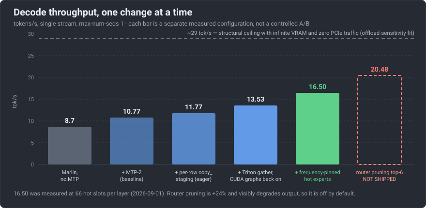
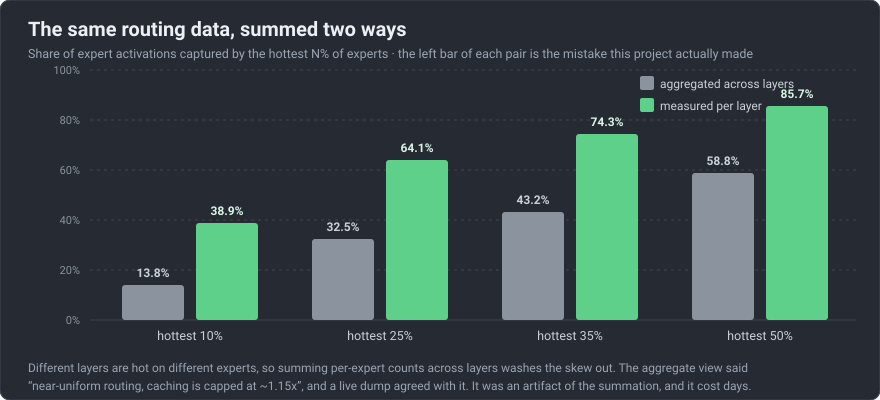

# GLM-5.3-Flash on one 96 GiB GPU

A 181 GiB language model, GLM-5.3-Flash, running on one 96 GiB graphics card in a desktop PC: 16.5 tokens (pieces of
words) a second at peak, 14.99 in the shipped setup. It is not turnkey: it needs the same kind of card and a
patched vLLM build. This is the record of how: what made it fit, what made it fast, and what did not.

One of the eight bugs on the way gave no error at all: the model just repeated the same token forever.
**[How to get it running, and that bug: RUNNING →](RUNNING-GLM53-ON-ONE-GPU.md)**

<p align="center">
  
</p>

Each bar is one measured setup. For scale, plain offloading gave 10.77 (the second bar).
[How it got fast](#how-it-got-fast) explains the third to fifth bars, plus one change for long prompts that is not charted.

GLM-5.3-Flash is a mixture-of-experts model: it is built from many small sub-networks, its experts, and uses only a
few of them for each token. It fits because 90% of the model is those experts, and each token uses only 8 of the 288
per layer. The experts stay
in the computer's main memory, and the card fetches the ones each token needs over PCIe, the link between the card
and the rest of the machine.

## What you get

- **A model nearly twice the size of the card's memory, served from one card,** with its output unchanged.
- **Where the time goes, measured.** For each token written, 58% of the GPU's busy time goes to fetching experts over
  PCIe (torch profiler, median of 12 steps). The work is moving bytes, not computing.
- **What not to try.** A dozen-plus ideas were measured and closed, from a bigger cache to native 4-bit kernels.

## Proof

Measured in September 2026 on one machine: AMD Ryzen 9 9950X3D, 182 GiB of dual-channel DDR5, one RTX PRO 6000 Blackwell, PCIe 5.0
x16. One request at a time.

- **Decode (writing the answer): 16.50 tokens/s** at peak, sustained over 8 back-to-back 200-token answers with 66
  experts per layer on the card; 14.99 in the shipped setup, which keeps 54 to leave room for long prompts. Runs vary
  by about ±1 token/s.
- **Prompt reading (prefill): 1,771 and 1,729 tokens/s** on two fresh prompts of about 10,300 tokens, 5.82 and 5.96 s to the
  first token (logged in [artifacts/prefill-fresh-2026-09-02.txt](artifacts/prefill-fresh-2026-09-02.txt)).
- **Context: one 304,800-token prompt** read in 205 s, 93% of the 327,680 configured.
- **Output unchanged on the prompt-reading path:** over 13,519 prompt tokens, its per-token log-probabilities stay inside the
  baseline's own run-to-run spread.
- **Stability:** 40 varied requests plus a 35,553-token prompt, 0 failures.

## How it got fast

Three changes made the difference; the first two are bars in the chart:

1. **Read the experts in wide blocks.** Narrow, scattered loads across PCIe were the slow part. A gather kernel, a
   small GPU program that reads wide and contiguous, took 10.77 to 13.53 tokens/s.
2. **Keep the hot experts on the card, not the first ones.** In each layer, 35% of the experts get 74% of the
   picks. So more of the model moved off the card (125 GiB instead of 105) and the freed memory became a cache of
   the most-used experts: 16.50.
3. **Read long prompts in groups.** A long prompt touches nearly every expert. Staging them 64 at a time took prompt
   reading from 614 to about 1,750 tokens/s.

<p align="center">
  
</p>

## Reproduce it

**This is not turnkey.** It needs a 96 GiB RTX PRO 6000 Blackwell card, host memory for the 125 GiB of experts the
shipped setup keeps there (the test machine had 182 GiB), vLLM pull request #53906 (released in vLLM 0.30.0, after these tests; not re-run on 0.30.0 or later), and the patch in
this repository. Without them you can still read where the time goes and reuse the ideas.

```bash
git clone https://github.com/pctablet505/glm53-flash-single-gpu
cd glm53-flash-single-gpu
less RUNNING-GLM53-ON-ONE-GPU.md   # the build recipe and the eight bugs, in order
less config/serve-opt.sh           # the shipped launch settings, each with its reason
```

The full steps are in [the full record](docs/FULL-RECORD.md#reproduce-it).

## Limits

- One machine, one checkpoint and one pre-release vLLM build with local patches.
- Most numbers are single runs, with about ±1 token/s of spread.
- Using fewer experts per token reaches 20.48 tokens/s but hurts the output; it is off.
- One known output defect is not fixed. It affects every NVFP4 (4-bit weights) mixture-of-experts checkpoint made with
  NVIDIA's modelopt tool, not only this one ([RUNNING §8](RUNNING-GLM53-ON-ONE-GPU.md#8-not-fixed)).

## Where next

- [RUNNING](RUNNING-GLM53-ON-ONE-GPU.md): get it running correctly; the eight bugs, the silent one included.
- [The full record](docs/FULL-RECORD.md): every result with its conditions, stability, coding-agent use and
  [what did not work](docs/FULL-RECORD.md#what-did-not-work).

The day-by-day account, mistakes included: the [lab notebook](LAB-NOTEBOOK.md).

## License

Documents and `config/` are MIT; `src/` comes from vLLM and stays Apache-2.0 ([LICENSE](LICENSE)). Model weights, the
vLLM fork and FlashInfer keep their own licences; nothing here redistributes them.

---

<picture><source media="(prefers-color-scheme: dark)" srcset="assets/mark-dark.svg"></picture>
<sub>**Real numbers, failures left in.** One of the [open-source tools of RL Alpha Labs](https://rlalphalabs.com/tools/), built by [pctablet505](https://github.com/pctablet505).</sub>
