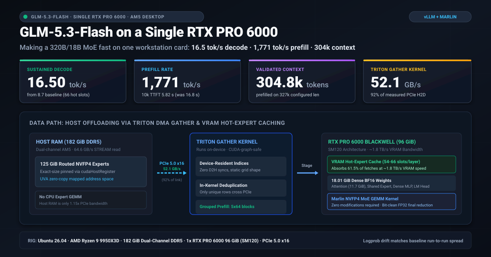

# The full record: GLM-5.3-Flash (320B/18B, NVFP4) on **one** RTX PRO 6000

This page keeps everything that used to be on the repository's front page, word for word: every result with its
conditions, the hardware, the context and prefill measurements, stability, the full reproduction steps, the
agent-backend notes, what did not work, the document map and the honest limits. The short version is the
[README](../README.md).

**~16 tok/s decode · ~1750 tok/s prefill · 304,800-token prompt prefilled on a single 96 GiB card.**

<p align="center">
  
</p>

A 181.3 GiB checkpoint served efficiently from a single 96 GiB GPU on a consumer desktop, with no
loss of output quality.

## What this repository is

An engineering log, not a product. Over five days one person got
[GLM-5.3-Flash](https://huggingface.co/dealignai/GLM-5.3-Flash-ABLITERATED-NVFP4)
(320B total / 18B active, NVFP4) running on a single RTX PRO 6000 Blackwell
workstation card, and then made it roughly 1.5x faster to decode and 2.9x faster
to prefill. This repository records:

- the **eight bugs** between a fresh checkout and correct output, one of which
  produces no error at all, just a model that emits the same token forever;
- the **three optimizations** that produced the numbers above, with the code
  ideas behind them;
- at greater length, the **dozen-plus things that were measured and did not
  work**, which is the part most likely to save you time.

If you are here because you want to run a too-large MoE on one card, read
[RUNNING](../RUNNING-GLM53-ON-ONE-GPU.md) then
[OPTIMIZING](../OPTIMIZING-GLM53-ON-ONE-GPU.md). If you are here because you are
about to try one of the ideas below, check [§ What did **not** work](#what-did-not-work)
first: several plausible ones are already closed by measurement.

> ### Status and caveats: read before quoting anything here
>
> - This is a **research log against a moving target**: a specific unreleased
>   vLLM fork (PR #53906, `0.29.0.dev0+glm53`) plus local patches, one specific
>   NVFP4 checkpoint, one machine, one operator. It is **not a supported
>   product** and nothing here is packaged, versioned, or CI-tested.
> - Most figures are **single runs or small-n**, taken on a desktop that was
>   also being used. Run-to-run spread on decode is about **±1 tok/s**; treat
>   differences smaller than that as noise, and we try to say so where it
>   matters.
> - Claims that were later shown to be wrong are **struck through or boxed, not
>   deleted**, including a couple that were reversed twice. The reversal is
>   usually the useful part.
> - The honest framing of the headline: this is **the best result we know of for
>   this model on a single RTX PRO 6000, and we could not find a better
>   published figure.** That is a statement about our search, not a record
>   claim.

> ### Update: later on 2026-09-02
>
> Five things changed after the body of this page was first written:
>
> - **Context was raised and, for the first time, validated.**
>   `--max-model-len` went 262,144 → **327,680**, and a **304,800-token prompt
>   now prefills successfully** (205 s, 1,487 tok/s). The important part is
>   *why* it did not work before: the usable ceiling is set by **free VRAM**,
>   not by `--max-model-len` (§ *Context*).
> - The hot-expert cache dropped **62 → 54 slots** to fund that, and the
>   throughput cost of cutting slots turns out to have been **over-claimed**
>   here: 48 slots measure 14.92 tok/s against 54 at 14.99 (§ *Context*).
> - **The `--max-num-batched-tokens 8192` floor is real after all.** This page
>   previously withdrew it as an artifact of a different bug. Re-tested with
>   that bug fixed, **4096 still kills the engine on the first request**
>   (§ *Stability*). This closes the obvious way to buy VRAM headroom.
> - Agent sessions that appeared to "forget their context" were **the engine
>   dying mid-turn**, not client truncation (§ *Using it as an agent backend*).
> - `reasoning_effort` was measured rather than assumed: the template accepts
>   only `low` / `high` / `max`, **anything else silently becomes `max`**, and
>   `max` is usually the wrong choice (§ *Using it as an agent backend*).
>
> Earlier the same day: prefill, not decode, turned out to be the largest
> quality-neutral win (614 → **1729–1771 tok/s**, logged in
> [`artifacts/prefill-fresh-2026-09-02.txt`](../artifacts/prefill-fresh-2026-09-02.txt)),
> and a "bit-identical" correctness claim was withdrawn because the *test* was
> invalid, not because the fast path was wrong (§ *Prefill*).

We are not aware of a faster published single-RTX-PRO-6000 figure for this
model. The nearest published comparison we have is FreeToken's **14.9 tok/s for
GLM-5.2** on the same GPU, but paired with a Xeon Platinum 8559C whose host
memory bandwidth is ~2.8x ours (§ *Hardware*). That makes the interesting part of
this result the *platform*, not the peak: a consumer AM5 desktop is a much worse
place to stream 125 GiB of expert weights from, and most of the work below is
about not paying for that.

---

## The result, with its exact conditions

| | |
|---|---|
| **Decode, peak measured** | **16.50 tok/s**, sustained over 8 back-to-back 200-token generations (2026-09-01, 66 hot slots, 262k context) |
| **Decode, shipped configuration** | **14.99 tok/s** at the shipped 54 hot slots, against 14.92 at 48 slots on the same benchmark; the difference is inside the ±1 tok/s run-to-run spread. At 62 slots the same build measured **15.8 tok/s** on prose and **17.1 tok/s** on a coding prompt as whole-request rates. **None of these are a controlled A/B against the 16.50 row**: context, slot count, prefill mode and CUDA-graph mode all differ |
| best single 10 s window observed | 17.4 tok/s (2026-09-01 configuration) |
| decode *at long context*, streamed | **18.2 – 18.4 tok/s** at 10k, **17.5 – 18.4 tok/s** at 35k across two runs |
| **Prefill** | **1771 / 1729 tok/s** on two fresh ~10.3k-token prompts (TTFT **5.82 s** / **5.96 s**); **1576 tok/s** on a fresh 35,571-token prompt (TTFT **22.57 s**). Logged: [`artifacts/prefill-fresh-2026-09-02.txt`](../artifacts/prefill-fresh-2026-09-02.txt) |
| prefill *before* grouped staging | **614 tok/s**: a 10,296-token prompt took **16.8 s** to the first token |
| **Longest prompt actually prefilled** | **304,800 tokens**, TTFT **205 s** = 1,487 tok/s, 93% of the advertised context (§ *Context*) |
| a 14-token prompt (below the gate, zero-copy path) | TTFT **0.85 s**, the control that makes the gate legible |
| an exact repeat of a prompt | ~3.2 s to the first token (aligned-prefix reuse) |
| model | `dealignai/GLM-5.3-Flash-ABLITERATED-NVFP4`: 320B total / 18B active, 45 layers, 42 MoE layers, 288 routed experts, top-8 |
| checkpoint on disk | 181.29 GiB (163.27 GiB of it routed experts) |
| context configured | `--max-model-len 327680` (was 262,144 until 2026-09-02) |
| context *of the decode measurements* | short prompts (tens of tokens), 200-token generations. Decode rate is roughly flat in context on this stack when measured streamed; an earlier run put 512k at ~7% below 256k |
| batch shape | `--max-num-seqs 1`, one stream, no concurrency |
| speculative decoding | MTP, `num_speculative_tokens: 2`. On a coding prompt at T=0: **64% of draft tokens accepted = 1.28 per step** (position 0: 75%, position 1: 53%), i.e. 2.28 tokens per forward pass. A different generation measured 1.81 accepted/step; acceptance is generation-specific, always quote the prompt. Prose is ~55–60% |
| MoE kernel | `marlin` (**mandatory**; see [RUNNING](../RUNNING-GLM53-ON-ONE-GPU.md) bug 7) |
| offload | `--offload-backend uva --cpu-offload-gb 125 --cpu-offload-params experts` |
| hot-expert cache | **54** of 288 experts pinned in VRAM **per layer**, frequency-ordered, ~24 GiB. (66 was in effect when 16.50 was measured; slots are the only place VRAM headroom comes from, so this number walks down when headroom is needed: 68 → 66 → 62 → 54) |
| grouped prefill staging | `VLLM_MOE_PREFILL_GROUPS=1`, gated to prompts of **≥ 48 tokens** |
| KV cache | **derived from the context**, `MAX_LEN × 17,200 B` → 5,636,096,000 B (~5.25 GiB) → **375,543 tokens** at 327,680 context = 1.15x concurrency. Measured cost is 15.0–15.7 KiB/token |
| CUDA graphs | **on** (piecewise) but **not breakable**: `VLLM_USE_BREAKABLE_CUDAGRAPH=0`. Both halves of that are load-bearing; see § *Stability* |
| stability | 40 varied requests (T=0/0.7/1.0, four 9k-token prefills) plus a 35,553-token prompt: **0 failures, 0 Xid, 592 s** |
| quality | unmodified. The fast prefill path is *numerically indistinguishable from the baseline's own run-to-run variability*, measured per-token on 13,519 prompt logprobs (§ *Prefill*). Router pruning (+24%) exists but is **not shipped** |
| engine | vLLM PR #53906 (`0.29.0.dev0+glm53`) + local patches, FlashInfer 0.6.18 |

### Hardware

Everything in this repository was measured on one machine:

Ubuntu 26.04 (kernel 7.0.0, glibc 2.43) · AMD Ryzen 9 9950X3D (16c/32t) on an
X870E AORUS ELITE X3D · **182 GiB DDR5, dual-channel** · 1× RTX PRO 6000
Blackwell Workstation Edition (SM120 / cc 12.0, 97,887 MiB VRAM, 94.97 GiB
visible to torch) · PCIe 5.0 x16 · driver 595.84 / CUDA 13.2 · **no swap**.

Measured platform bandwidths (all from this box, not datasheets):

```
CPU STREAM read        64.6 GB/s     <- dual-channel, NOT quad
PCIe 5.0 x16 H2D       56.4 GB/s
PCIe 5.0 x16 D2H       57.3 GB/s
our gather kernel      52.1 GB/s     <- 92% of H2D ingress
VRAM                 ~1800 GB/s      (vendor figure, not measured here)
```

The single most important number on that list is **64.6 GB/s**. Host RAM is only
1.15x PCIe here, which kills every "compute the offloaded experts on the CPU
instead" design before it starts; see
[FURTHER §5](../FURTHER-OPTIMIZATION-RESEARCH.md#5-dead-cpu-co-execution-freetoken-hybrid).

---

## The story in one paragraph

90% of this checkpoint is routed MoE experts, and only 8 of 288 per layer are
touched per token, so the experts live in pinned host RAM behind a UVA
(zero-copy) mapping and the GPU reads what routing selected. That naive version
runs at **10.77 tok/s**, and profiling says essentially all of it is one PCIe
transfer. Three changes moved it. First, the transfer was slow not because the
memory is remote but because `index_select` gathers it with narrow scattered
loads across the PCIe BAR; replacing that with a wide contiguous **Triton gather
kernel that takes its indices as a device tensor** roughly doubled the effective
link rate *and*, because it needs no host sync, let CUDA graphs come back on,
worth another 13%: **13.5 tok/s**. Second, vLLM's offloader decides residency
*per layer, in module order*, so the experts that stay in VRAM are arbitrary.
Routing is in fact strongly skewed **within** each layer: the hottest ~36% of a
layer's experts serve 75% of its fetches, so we offload *more* (125 GiB instead
of 105) and spend the VRAM that frees on a **frequency-ranked hot-expert cache**,
66 slots per layer, selected by a device-side slot table the same kernel reads:
**16.5 tok/s**. Third (and this one is not about decode at all), a *prefill*
chunk routes to essentially every expert, which blew past the staging buffer and
fell back to zero-copy BAR reads at ~23 GB/s; walking the experts in 64-wide
groups and DMA-staging each group took prefill from **614 to ~1750 tok/s**.
Everything else we tried (a bigger LRU cache, native-FP4 kernels, CPU
co-execution, GPUDirect Storage, deeper speculation, n-gram drafting, per-layer
slot water-filling, re-profiling the hot set on a mixed workload, raising
`gpu-memory-utilization`) was measured and closed.

---

## How the number moved

| step | tok/s | what changed |
|---|---|---|
| marlin, no MTP | 8.7 | first correct output at all |
| + MTP-2 | 10.6 – 12.1 | one expert fetch verifies ~2.2 tokens |
| baseline used for optimization work | **10.77** | offload 105, 512k, no staging |
| + per-row `copy_` staging, eager | 11.77 | DMA engine instead of BAR reads, but `.tolist()` forced `--enforce-eager` |
| + Triton dedup gather, device indices | **13.53** | same staging, CUDA-graph-capturable → graphs back on (+13%) |
| + frequency-pinned hot experts (offload 125, 66–68 slots) | **16.1 – 16.8** | 61.5% of host-side fetches served from VRAM |
| − slots spent on long-context headroom (54) | ~15 | see § *Context*; the cost is inside the run-to-run spread |
| *(opt-in, **not shipped**)* router pruning top-6 | *20.48* | +24%, **visible quality loss** |

And the same table for **prefill**, which no decode benchmark had ever shown:

| step | prefill tok/s | 10k-token TTFT | what changed |
|---|---|---|---|
| zero-copy BAR reads (every configuration above) | 614 | 16.8 s | a prefill chunk exceeds the 64-expert staging buffer, so staging declines and Marlin re-reads every offloaded expert over the BAR |
| + grouped DMA staging, all prompts | ~1750 | ~5.9 s | but a 14-token prompt now paid **2.05 s** to first token, against 0.85 s zero-copy; see § *Prefill* |
| + gate at ≥ 48 prompt tokens *(shipped)* | **1729 – 1771** | **5.82 – 5.96 s** | short prompts go back to zero-copy, which is cheaper for them |

Three of those rows are counter-intuitive and worth stating plainly:

- **Offloading *more* made it faster.** At offload 125 with no pinning the same
  server does **11.34 tok/s**, the *worst* of the three configurations, because
  more bytes cross PCIe and nothing absorbs them. Offload 105 with no pinning is
  13.73. The 125 + 66-slot combination is 16.5. The offload and the cache are a
  **matched set**; changing one without the other loses most of the gain.
- **CUDA graphs are worth 13% here**, on a workload where the GPU spends most of
  its time waiting on PCIe. Eager mode costs an entire forward pass of launch
  overhead per step (11.77 vs 13.53 with identical staging). This is why the
  gather kernel had to take *device-side* indices rather than doing the obvious
  `topk_ids.tolist()` loop.
- **The 2.9x prefill win and the 24% decode win came from the same staging
  buffer**: one by using it, one by *not* using it. Grouping helps a 10k-token
  prompt and hurts a 14-token one, because a short prompt routes to far fewer
  experts than the 288 a group walk stages. The crossover is ~40 tokens.

---

## Context: the advertised ceiling is not the usable one

The context was `--max-model-len 262144` for most of this work and had **never
been prefilled anywhere near that length**. When it finally was, it failed, and
raising the number did not help, because the number was not the constraint.

**Long-prompt activations are allocated per request and scale with sequence
length.** Attention workspaces and the sparse indexer are not reserved up front,
so what decides whether a 200k-token prompt survives is **how much VRAM is free
at that moment**, not what `--max-model-len` says. Measured, varying only the
hot-expert slot count (which is the only thing that frees VRAM here; see below):

| hot slots | free VRAM | longest prompt that prefilled | TTFT |
|---|---|---|---|
| 60 | 3,397 MiB | **a 180k-token prompt died**: `CUDA out of memory. Tried to allocate 116.00 MiB` | n/a |
| **54** *(shipped)* | 6,177 MiB | **304,800 tokens**, 93% of the advertised 327,680 | 205 s (1,487 tok/s) |
| 48 | 8,817 MiB | 233,670 tokens *(the largest tried at this setting, not a limit)* | 158 s |

**The rule this produced: never advertise a context you have not prefilled at.**
Both earlier settings (262,144, and the first attempt at 327,680) were
advertised and never tested near their limit.

**Paying for it was nearly free.** The obvious objection is that hot slots are
what makes decode fast, so cutting them should cost throughput. Measured, it
barely does: **48 slots → 14.92 tok/s, 54 slots → 14.99 tok/s**, 0.07 apart,
inside the ±1 tok/s run-to-run spread, because 48 → 54 is only about **3 points
of cache hit rate**. Earlier versions of these documents implied the slot cost
was larger than that; **that was an over-claim**. In this range the slot count is
a weak lever and the headroom is cheap. (It is *not* weak across the whole range:
the ladder from 0 slots to 66 is the entire 13.5 → 16.5 tok/s win.)

**The KV cache now derives from the context**, so the two cannot disagree:

```bash
KV_BYTES="${KV_BYTES:-$(( ${MAX_LEN:-327680} * 17200 ))}"
```

17,200 B/token is the measured 15.0–15.7 KiB/token plus ~10% headroom on the
worse figure (4 GiB gave 272,771 tokens; 5.25 GiB gave 375,543). This matters
for anything that drives the launcher with only *some* of its knobs: the local
supervisor GUI we use passes `MAX_LEN` but not `KV_BYTES`, so moving a context
slider used to leave the KV cache sized for the old context, and vLLM then
refused to start with *"N GiB KV cache is needed, larger than the available"*.
Deriving one from the other removed a whole class of confusing startup failures.

**The natural alternative is closed.** Long-prompt activation scales with
*chunk × length*, so shrinking `--max-num-batched-tokens` should buy the same
headroom far more cheaply. It cannot: 4096 kills the engine outright
(§ *Stability*). That is why the headroom has to come from hot slots.

---

## Prefill

Every number above this line is a *decode* number, and for a day that was the
only thing being measured. It hid the term that actually dominates an agentic
coding turn: **time to the first token.**

Measured on the 16.5 tok/s configuration, streamed, before any prefill work:

```
10,296-token prompt   TTFT 16.8 s   =  614 tok/s prefill   (decode after: 18.8 tok/s)
                                       262k context extrapolates to ~7 minutes
```

**Why it was slow.** A prefill chunk routes to essentially *all* 288 experts, so
`n > MAX_STAGED_EXPERTS` (64), `stage()` returns `None`, and Marlin falls back to
reading every offloaded expert zero-copy over the PCIe BAR (~23 GB/s, with tile
re-reads) instead of the 52 GB/s DMA gather that decode uses. Decode was fast
*because* it touches only 8 experts per layer; prefill was slow for exactly the
same reason inverted.

**The fix** (`VLLM_MOE_PREFILL_GROUPS=1`) walks the 288 experts in 64-expert
groups per layer, DMA-stages each group (hits from the hot cache count), runs
`moe_align_block_size` + the inner `_fused_marlin_moe` per group into the **same**
per-pair workspace, and finishes with one fp32 `moe_sum` over the `[M, topk, K]`
view. Every `(token, expert)` pair belongs to exactly one group, so the groups
fill disjoint rows of one buffer rather than producing partial sums to add up.

Measured on the shipped server (bare `./serve-opt.sh` defaults), streaming,
TTFT = time to the first content chunk, with **prompt salts never sent to that
server before** so nothing could come from the prefix cache; logged in
[`artifacts/prefill-fresh-2026-09-02.txt`](../artifacts/prefill-fresh-2026-09-02.txt):

| prompt | tokens | TTFT | prefill | decode after |
|---|---|---|---|---|
| 10k fresh #1 | 10,313 | **5.82 s** | **1771 tok/s** | 18.2 tok/s |
| 10k fresh #2 | 10,314 | **5.96 s** | **1729 tok/s** | 18.2 tok/s |
| 30k fresh | 35,571 | **22.57 s** | **1576 tok/s** | 18.4 tok/s |
| 14-token control (zero-copy path) | 14 | **0.85 s** | n/a | n/a |

against **614 tok/s / 16.8 s** on the same class of 10k-token prompt before
grouping. Decode is unaffected: 18.2–18.4 tok/s at these contexts. At the far
end, a **304,800-token** prompt prefills in 205 s = 1,487 tok/s.

*(An earlier, unlogged "1762 tok/s / 5.8 s" is quoted in the launcher comment and
in a few places below. The logged range above supersedes it; the two agree to
within the spread of two runs, which is exactly why it is worth logging.)*

Two failures on the way there are worth more than the win:

**1. Do not accumulate partial outputs.** A first draft summed five bf16 partial
results and flipped tokens at T=0. Writing disjoint rows of one workspace and
reducing once in fp32 is not a stylistic preference; it is the difference
between correct and not. (Relatedly, `moe_sum` needs the 3-D view or its C++ op
fails with `aoti_torch_get_stride`.)

**2. The short-prompt trap, and the measurement mistake it caused.** The first
shipped version grouped *every* prefill, including a 14-token prompt that only
routes to ~100 experts, so it staged all 288 and paid **2.05 s** to the first
token, against the **0.85 s** the zero-copy path takes on that same prompt. The
200-token benchmark then read **12.5 tok/s instead of 15.8**, and that was
misread as a *decode* regression. It was not: the decode rate itself was
unchanged, and streaming TTFT separately from the inter-token rate showed it
immediately. The same arithmetic explains a 40-request soak taken during that
window: a 150-token math generation at 16.7 tok/s takes 9.0 s, and adding 2.05 s
of TTFT predicts 13.6 tok/s end-to-end against 13.9 measured, while the
9,107-token class went **7.83 → 11.34 tok/s** in the same run. The gate
(`topk_ids.shape[0] >= 48`, static per captured graph, so CUDA-graph-safe) sends
short prompts back to zero-copy.

**Always separate TTFT from decode before calling anything a decode regression.**

### The correctness claim, and why the first version of it was worthless

The launcher and the source comment for this path used to say the grouped result
is *"bit-identical to the single pass (T=0 outputs identical on 3k and 10k
prompts)"*. **That test proves nothing, and the claim is withdrawn**: both
comments were corrected in the engine tree on 2026-09-02 and now state the
fresh-prompt logprob equivalence instead.

Baseline prefill on this stack, with no code change at all, produces different
output run to run. The same 3k and 9k prompts at T=0, `max_tokens=40`, hashed
A, B, A across three runs of the *unmodified* build. The pattern matches
prefix-cache state reuse (mamba `align` mode caches state at scheduler-step
boundaries; a continuation from cached state rounds differently in bf16 and
flips a knife-edge argmax), not a race. Two lucky draws produced "identical" and
were briefly believed. A masked-group variant was then *wrongly* blamed and
removed for "nondeterminism" the baseline has as well.

The valid test compares **per-token prompt logprobs on fresh prompts** and
measures the candidate against the baseline's *own* fresh-vs-cached drift:

| comparison | tokens | p50 | p90 | p99 | max | \|Δ\| > 1 nat |
|---|---|---|---|---|---|---|
| baseline vs itself (fresh vs cached), 3k | 3,219 | 0.000006 | 0.00054 | 0.057 | 3.75 | 6 (0.19%) |
| baseline vs itself (fresh vs cached), 9k | 10,300 | 0.000011 | 0.00013 | 0.0065 | 4.41 | 5 (0.05%) |
| **grouped vs baseline**, 3k | 3,219 | 0.000008 | 0.00069 | 0.075 | 4.26 | 4 (0.12%) |
| **grouped vs baseline**, 9k | 10,300 | 0.000012 | 0.00022 | 0.014 | 5.01 | 7 (0.07%) |

The honest statement is therefore: **grouped prefill is numerically
indistinguishable from the baseline's own run-to-run variability**, not that it
is bit-identical. Both distributions put half of all tokens within 10⁻⁵ nats and
both put ~0.1% of tokens more than 1 nat away.

### Prefix caching, partially

`--enable-prefix-caching` is on, and re-sending an identical prompt is now
noticeably cheaper: ~3.2 s to first token for the same 10k prompt. It is not
reliable and it is not observable: the same test measured **no** benefit
earlier in the day (16.6 s → 16.9 s on an identical re-send) and 9.6 s on
another run, and `vllm:prefix_cache_hits` / `vllm:prefix_cache_queries` read
**0/0** across every one of these requests, so timing is the only evidence we
have. Coding agents resend the whole conversation each turn, so this is worth
more than it looks, and worth measuring on your own traffic rather than
trusting.

---

## Stability

The engine used to die mid-serving with `CUDA error: an illegal memory access`.
The kernel log names it: `Xid 31 ... MMU Fault`. The Python traceback points at
the FlashInfer sparse-MLA backend, but CUDA's own message warns that such errors
are *reported asynchronously at some later call*: a stack is where the error was
noticed, not where it was caused. (For scale: zero such faults in 22 runs and
~80 requests the day before it started.)

Two changes were made, and the pair holds:

1. **Bounds-check every id-indexed access in the staging path**: both Triton
   gather kernels, `build_local_expert_map`'s `scatter_reduce_`, and the Marlin
   call site. A padded or sentinel expert id (`-1`, or `n_experts`) would index
   past the host tensor, or read garbage past the slot table and then
   *dereference that garbage*, which is precisely an unmapped address, i.e.
   this Xid.
2. **`VLLM_USE_BREAKABLE_CUDAGRAPH=0`.** vLLM auto-enables "breakable" CUDA
   graphs for this hybrid model. Every build that ran under breakable graphs on
   2026-09-02 faulted between request 2 and request 24. With it off, a
   40-request varied soak at T=0/0.7/1.0, including four 9k-token prefills and
   a 30k-token prompt, ran with **0 failures and 0 Xid at unchanged speed
   (15.77 tok/s)**, and the later shipped build repeated that with a 35,553-token
   prompt added.

**The mechanism is not proven.** What supports it: the profiler had shown kernels
overlapping across streams while the staging buffers are shared, which is
consistent with a race that breakable mode makes possible. Treat
`VLLM_USE_BREAKABLE_CUDAGRAPH=0` as a measured fix with an unproven cause.

### `--max-num-batched-tokens 8192` is a floor: reversed, then reversed back

This one changed twice in one day and the sequence is the point.

> **First claim (early 2026-09-02).** *"8192 is a floor; 2048 and 4096 both die
> with an illegal memory access on the second request."*
>
> **Withdrawn the same day**, because the *same* fault then hit a run at
> **8192** after 12 requests. Smaller batch sizes looked causal only because
> they changed the allocation layout, so the corruption surfaced on request 2
> instead of request 12. Attributing it to a batch size was pattern-matching.

> **RE-TESTED and REINSTATED (2026-09-02, ~07:5x).** With
> `VLLM_USE_BREAKABLE_CUDAGRAPH=0` shipped (so the Xid 31 fault is gone) and
> the staging bounds checks in place, **`MAX_BATCHED=4096` still dies**: a 500
> on the very first short decode request, and a dead engine behind it.
>
> **The floor is real and it is a separate failure from the Xid 31 bug.** Treat
> 8192 as a hard floor. The intermediate "it was an artifact" conclusion was
> wrong; the withdrawal was correct about the *evidence* (8192 did fault) and
> wrong about the *conclusion* (that nothing else was going on).

The consequence is not academic. Long-prompt activation scales with
chunk × length, so shrinking the prefill chunk is the obvious, cheap way to buy
VRAM headroom for long context. That lever is closed, which is why headroom has
to come out of hot-expert slots instead (§ *Context*).

### The SM120 attention backend is not available

vLLM lists two sparse-MLA candidates on this card and picks
`FLASHINFER_MLA_SPARSE_SM90`, i.e. the Hopper kernel running on Blackwell by the
fallback described in
[RUNNING bugs 5–6](../RUNNING-GLM53-ON-ONE-GPU.md#bugs-5-6--the-rope-free-lane-is-unreachable-on-sm120).
Forcing the native `FLASHINFER_MLA_SPARSE_SM120` fails at startup:

```
SM120 sparse MLA v32/GLM expects kv_lora_rank=512, qk_rope_head_dim=64,
and query head dim 576
```

GLM-5.3 is NoPE MLA (`qk_rope_head_dim=0`, latent 512), so the native SM120
kernel would need the same shape-assumption surgery the SM90 path already got.
This was the *other* candidate fix for the Xid; it is closed.

---

## Reproduce it

### 1. Build

The CUDA toolchain is a triple constraint on this platform and only one point
satisfies it. See [RUNNING §1](../RUNNING-GLM53-ON-ONE-GPU.md#1-build-environment)
for the full recipe, the `nvcc`-vs-headers guard, and the `lib64` shim.

You need vLLM from **PR #53906** (Glm5Next support; it is in no released vLLM)
plus the source changes in [`GLM53-SM120.patch`](../GLM53-SM120.patch).

### 2. Generate the hot-expert profile

The frequency profile is **not** shipped with a checkpoint; it is recorded from
your own traffic, and it is **tied to the `cpu_offload_gb` it was recorded at**
(residency is a whole-layer decision, so a different offload means a different
set of host-side layers and the layer indices stop lining up: a profile from
offload 125 used at 127 measured 15.09 vs 16.76 tok/s, *silently*).

```bash
# Run with pinning OFF and the recorder ON, at the offload you intend to serve at.
CPU_OFFLOAD_GB=125 VLLM_MOE_HOT_SLOTS=0 \
VLLM_MOE_SKEW_PERLAYER=/path/to/hot-profile-125.json \
  ./serve-opt.sh
# Then drive it with representative traffic, at temperature 0. The file is
# rewritten every 6000 staged steps; ~12000 steps was enough here for a stable
# ranking.
```

### 3. Serve

`serve-opt.sh` is the launcher, and it lives in the vLLM working tree rather
than in this repository, because every default in it is tied to that tree's
patches. On this machine that is `~/Projects/vllm-glm53`; substitute your own
checkout path throughout.

```bash
cd ~/Projects/vllm-glm53 && ./serve-opt.sh
```

which is, expanded (this is the currently shipped configuration):

```bash
export CUDA_HOME="$VENV/lib/python3.13/site-packages/nvidia/cu13"
[ -e "$CUDA_HOME/lib64" ] || ln -sfn lib "$CUDA_HOME/lib64"   # FlashInfer JIT hardcodes -L$cuda_home/lib64
export PATH="$VENV/bin:$CUDA_HOME/bin:$PATH"
export TORCH_CUDA_ARCH_LIST=12.0f
export VLLM_USE_FLASHINFER_SAMPLER=0
export VLLM_USE_DEEP_GEMM=0                        # SM100-only paged-MQA on the MTP path
export VLLM_WEIGHT_OFFLOADING_DISABLE_PIN_MEMORY=1 # counter-intuitive; see RUNNING bug 2
export PYTORCH_ALLOC_CONF=expandable_segments:True,pinned_use_cuda_host_register:True,pinned_num_register_threads:8

export CPU_OFFLOAD_GB=125
export VLLM_MOE_HOT_SLOTS=54                       # funds long-context headroom; see "Context"
export VLLM_MOE_HOT_PROFILE=$ROOT/hot-profile-125.json
export VLLM_MOE_PREFILL_GROUPS=1                   # 2.9x prefill; see "Prefill"
export VLLM_USE_BREAKABLE_CUDAGRAPH=0              # stops the Xid 31; see "Stability"

MAX_LEN=327680
vllm serve dealignai/GLM-5.3-Flash-ABLITERATED-NVFP4 \
  --served-model-name glm53-flash --host 0.0.0.0 --port 8002 \
  --max-model-len $MAX_LEN \
  --gpu-memory-utilization 0.95 \
  --tensor-parallel-size 1 --distributed-executor-backend mp \
  --offload-backend uva --cpu-offload-gb 125 --cpu-offload-params experts \
  --max-num-seqs 1 --max-num-batched-tokens 8192 \
  --limit-mm-per-prompt '{"image":0,"video":0}' \
  --kernel-config '{"moe_backend":"marlin"}' \
  --kv-cache-memory-bytes $(( MAX_LEN * 17200 )) \
  --enable-prefix-caching \
  --speculative-config '{"method":"mtp","num_speculative_tokens":2}' \
  --enable-auto-tool-choice --tool-call-parser glm47 --reasoning-parser glm47
```

Boot is ~5–6 minutes: 181 GiB load, then a **silent** multi-minute Marlin
repack at ~96% CPU with no log output (it is not a hang), then graph capture.

*(On the machine these notes come from, a small local supervisor GUI called
Coldstart sits in front of that launcher: it starts and stops the server,
adopts one that is already running, and shows decode **and** prefill tok/s. It is
not part of this repository and nothing here depends on it. It is mentioned only
because it is the reason `KV_BYTES` had to be derived from `MAX_LEN`: it passes
one and not the other.)*

### 4. The guards around it: do not skip these

`serve-opt.sh` refuses to start rather than take the machine down. Each guard
exists because the corresponding failure actually happened:

| guard | what it prevents |
|---|---|
| **host-RAM check**: `avail >= CPU_OFFLOAD_GB + 30` | There is no swap, and an OOM kill of a pinned allocation takes the desktop with it. The allowance was **45 until 2026-09-02**, set from a 110 GiB offload that peaked at ~168 GiB. Re-measured on the shipped configuration: steady state is **offload + ~16 GiB** (141 GiB used at offload 125), because the safetensors reads that inflated the original figure go through *reclaimable* page cache, which `MemAvailable` already discounts. **30** keeps a 14 GiB cushion over the measurement instead of a 29 GiB one, and stops the guard from refusing a launch that would have been fine. |
| **duplicate-launch check** (port bound, or another `vllm serve` from this tree) | A vLLM that OOMs on the GPU **hangs** instead of exiting, keeping its VRAM and its process tree. A second launch then stalls forever behind it with an empty log, which looks like a slow start. |
| **cwd shadowing check** (`vllm.__file__` must resolve under `$ROOT/src/vllm/`) | The repo root is *itself* a second, uncompiled vLLM checkout. Python puts cwd first on `sys.path`, so launching from `$ROOT` imports the copy with no compiled extensions and fails as *"vllm.vllm_flash_attn requires the CUDA flash attention extensions"*, which reads as a broken build. |
| **profile/offload mismatch warning** | A profile captured at a different `cpu_offload_gb` still parses and still runs. It just quietly costs ~10%. |
| **`lib64` symlink** | pip CUDA wheels lay out `lib/`; FlashInfer's JIT hardcodes `-L$cuda_home/lib64`. Without it the first forward pass fails to *link* and surfaces as the misleading `Ninja build failed`. |
| **`KV_BYTES` derived from `MAX_LEN`** | The two used to be set independently, so changing the context left the KV cache sized for the old one and vLLM refused to start (*"N GiB KV cache is needed, larger than the available"*). |

And three settings that must not be "tuned":

- **`--max-num-batched-tokens 8192` is a floor.** 4096 kills the engine on the
  first request even with every stability fix in place (§ *Stability*). This was
  briefly withdrawn as an artifact and then re-confirmed; see that section for
  the full sequence.
- **`--gpu-memory-utilization` buys nothing here.** 0.95 and 0.96 produce an
  identical KV cache and identical VRAM, because `KV_BYTES` is explicit and
  weights + hot cache are fixed. If you need headroom, take it from hot slots or
  raise the offload.
- **Do not re-profile the hot-expert set on mixed-temperature traffic.** Tried
  it; a profile captured over prose/code/chat/long/math at T=0/0.7/1.0 and an
  offload of 130 measured *worse on everything*: prose 13.02 vs 15.77, coding
  16.10 vs 17.10, prefill 1698 vs 1762 (the prefill figure current at the time),
  for +4 GiB of VRAM margin. Sampling at T>0 randomizes tokens and flattens
  routing, which is exactly the skew the profile is supposed to capture. Capture
  at T=0 on your real workload.

---

## Using it as an agent backend

This server is wired up as a coding backend, and two things about that turned
out to be worth more than a tok/s.

### "The model forgets its context" was the engine dying

Agent sessions (a VS Code coding assistant, and a terminal agent) would loop:
re-running the same first step (*"Let me start by exploring the codebase
structure"*) as if the conversation history were empty. The obvious suspects
are client-side truncation or a broken chat template.

It was neither. **Every `chat/completions` 500 in the logs coincides exactly
with an engine death:**

```
01:01:47   CUDA out of memory
01:39:16   CUDA out of memory
02:32:55   Xid 31 illegal memory access
```

83 of 86 agent requests returned 200; the three failures were those deaths. A
dead turn leaves a failed or empty assistant message in the client's history,
and GLM's chat template renders that as a *fresh* thread, so the model
genuinely re-plans from zero. What looks like amnesia is a crash. (Fixed by the
same two changes as § *Stability*.)

**The diagnostic order that worked: verify the server before blaming the
client.** One direct request to the server, outside the agent, answered four
questions at once: is `finish_reason` right (`tool_calls`), is `content` empty
because reasoning leaked into it (no: reasoning came back in its own field),
are the `tool_calls` well-formed (yes). Server exonerated in a single request;
everything after that was aimed at the logs instead of the client.

Two genuine client-side misconfigurations turned up alongside it:

- The editor's model config advertised **`maxInputTokens: 500000`** against a
  server serving 262,144. Set it to context − max output − a margin (227,328 at
  the time: 262,144 − 32,768 − 2,048). **Recompute it whenever you change the
  context**, which is now 327,680.
- A local proxy that bounds reasoning effort **streamed its retry**. When a turn
  came back answerless it retried, but streamed the retry too, so an answerless
  retry reached the client as a *second* blank turn. It now retries
  **non-streaming**, reuses the same answerless guard, and if the retry is still
  answerless emits an explicit bracketed notice rather than silence.

### `reasoning_effort`, measured

GLM-5.3's chat template accepts exactly three values (**`low`, `high`, `max`**),
and it is a *soft system line*, not a token budget. Anything else (unset, a
typo, the plausible-looking `medium`) **silently becomes `max`**. That is a trap:
the default is the most expensive setting, and nothing tells you.

Measured on one hard problem:

| effort | reasoning tokens | notes |
|---|---|---|
| `low` | 183 | |
| `high` | 484 | |
| `max` | 1,812 | ~2x the wall time of `high`, and it produced a **shorter** final answer |

Two consequences:

- **Thinking budget is not what makes turns blank.** Even `max` spent 1,812
  reasoning tokens, 7.2% of a 32,768-token output budget. Blank turns come from
  clients sending a small *per-request* `max_tokens`: at 512, `max` produces an
  empty turn (all budget spent thinking) while `high` still answers.
- **Use `high` for agent and tool loops**, where many cheap turns beat a few
  expensive ones. Keep `max` for one-shot hard questions *with a large output
  budget*, and expect it to cost about twice the wall time for no guaranteed
  gain in answer quality.

---

## What did **not** work

The most useful part of this repository. Everything here was measured on this
machine and closed; none of it is speculation.

| idea | why it seemed good | measured verdict |
|---|---|---|
| **Native FP4 MoE kernels** (FlashInfer CUTLASS, vLLM CUTLASS, b12x) | Marlin logs *"your GPU does not have native support for FP4"*, so its dequant looked like the stall | **Marlin is the fastest**, at every batch size: 77.4 µs at M=1 vs 99.8 / 110.0 / **409.4**. b12x served end-to-end at 1.2–1.3 tok/s. And two of them are *silently wrong* on SM120 (RUNNING bug 7) |
| **CPU co-execution of offloaded experts** (FreeToken-style hybrid) | Use idle CPU instead of PCIe | **0.895x, a regression.** Host RAM is 64.6 GB/s here, only 1.15x PCIe. The published wins come from server boards at ~178 GB/s |
| **GPUDirect Storage / NVMe as an additive path** | More ingress bandwidth | Dead: it converges on the same x16 ingress |
| **LRU / temporal expert caching** | The literature shows wins on Mixtral-class models | **9.0% hit rate** against 5.6% at random. GLM activates 8 of 288 (2.8%), far too sparse |
| **Water-filling per-layer slot budgets** | Some layers are more skewed than others | **+0.07 pp** of hit rate. The layers' hot *sets* differ but their distribution *shapes* are alike, so uniform allocation is already optimal |
| **Re-profiling the hot set on real mixed traffic** | The shipped profile came from one prose prompt at T=0 | **Worse on everything**: 13.02 vs 15.77 prose. Sampling at T>0 flattens routing, blurring the very skew the profile captures |
| **MTP depth 4** | More tokens per expert fetch | **Worse** (10.77 → 8.72). Acceptance nearly halves because GLM re-runs one MTP layer per draft step |
| **Deeper speculation (depth 4–5), n-gram / suffix drafting** | A free drafter stacked on MTP | Depth 5 exceeds the KV cap; depth 4 trips a DeepGEMM `block_kv` assert on arch 12. And at depth 2 a free drafter can only save the one MTP layer, ~2–3% of a step. **MTP-2 stays** |
| **Raising `--gpu-memory-utilization`** | The usual way to find VRAM | **Byte-identical results.** `KV_BYTES` is explicit and weights + cache are fixed; there is no slack to redistribute |
| **Shrinking `--max-num-batched-tokens`** | The cheap way to buy long-context headroom | **4096 kills the engine on the first request.** Closed (§ *Stability*) |
| **Reserving staging buffers before the cap check** | Makes vLLM's memory profiling see the hot cache and fail honestly at startup | Startup became correct and *serving* broke with an illegal memory access. **Reverted** |
| **The native SM120 sparse-MLA attention backend** | Stop running a Hopper kernel on Blackwell | **Refuses this model**: it expects DeepSeek's `qk_rope_head_dim=64` / 576-wide query; GLM-5.3 is NoPE |
| **FP8 for the 18 GiB of BF16 dense weights** | The profiler's second-largest term, ~5–6 ms/token | Measures **~31 dB SNR**: those are genuine BF16 masters, not upcast FP8, so it is a real quality cost, and **no pre-quantized checkpoint fits** (a full-FP8 build is ~331 GB against ~278 GB of total memory here) |
| **Router pruning to top-6 of 8** | +24%, and it works | **Rejected on quality.** Repetition loops (*"Jupiter (planet) (planet) (planet)"*) and word-salad explanations. Simple facts survive, which is what makes it dangerous on a spot check |

And one *analysis* mistake that cost more than any of them: summing per-expert
routing counts **across** layers said routing was near-uniform and capped every
caching idea at ~1.15x. Grouped **per layer**, the same raw data shows the
hottest 36% of a layer's experts serving 75% of its fetches, which is the entire
13.5 → 16.5 tok/s win. One `groupby` was the difference between a closed branch
and the result.

### Deliberately not shipped

**Router pruning.** GLM routes top-8; fetching only the 6 highest-weighted
experts cuts PCIe traffic and measures **20.48 tok/s vs 16.50, +24%**. It is
implemented, it is CUDA-graph-safe, and it is **off by default and will stay
off**, because output quality visibly degrades. This model is used for work where
a hallucination is expensive, so it does not trade quality for speed. Set
`VLLM_MOE_DECODE_TOPK=6` if you disagree, and own the consequences.

**The quality-neutral ceiling on this hardware is therefore ~16–17 tok/s.**
Reaching 25 requires stacking pruning *and* FP8 dense weights, and both change
model outputs.

---

## Document map

| file | what it is |
|---|---|
| [**RUNNING-GLM53-ON-ONE-GPU.md**](../RUNNING-GLM53-ON-ONE-GPU.md) | Getting it to run **correctly**: build constraints, memory layout, and the eight bugs, including one that produces no error at all. Start here. |
| [**OPTIMIZING-GLM53-ON-ONE-GPU.md**](../OPTIMIZING-GLM53-ON-ONE-GPU.md) | Getting it to run **fast**: the measured cost model, the gather kernel, hot-expert pinning, prefill grouping, stability, and the configuration knobs that do nothing. |
| [**FURTHER-OPTIMIZATION-RESEARCH.md**](../FURTHER-OPTIMIZATION-RESEARCH.md) | What is left, and what has since been struck off. Every 2026-09-01 recommendation now carries its measured verdict, which makes it a scorecard of predictions against outcomes. |
| [**LAB-NOTEBOOK.md**](../LAB-NOTEBOOK.md) | The chronological account: false starts, the mistakes that cost the most, and the operational traps. Read this one if you are going to do this yourself. |
| [**FINDINGS.md**](../FINDINGS.md) | One-page condensed version of RUNNING. |
| `GLM53-SM120.patch` | All source changes needed to make the model run on SM120. |
| `serve.sh` | The original (pre-optimization) launcher, kept because it is the *minimal correct* configuration. Superseded for speed by `serve-opt.sh`, which lives in the vLLM working tree. |
| `glm53-llamacpp-run.sh` | An abandoned llama.cpp/GGUF route, kept for reference. |
| `artifacts/` | Raw measurement logs referenced above, currently `prefill-fresh-2026-09-02.txt`. |

The optimization itself is three files in the vLLM working tree, not in this
repository (they are patches against a fork that is itself unreleased):

- `model_executor/offloader/dma_stage.py`: the Triton gather kernel, the
  hot-expert cache, the profile recorder.
- `model_executor/layers/fused_moe/experts/marlin_moe.py`: the hook into
  vLLM's MoE path, the bounds checks, the grouped-prefill group walk
  (`_prefill_groups_enabled`, and the `topk_ids.shape[0] >= 48` gate), and the
  opt-in router pruning.
- `serve-opt.sh`: every tuned default, each with the measurement that justifies
  it in a comment. If you read one file, read this one.

---

## Honest limits

- ~16 tok/s is usable for agentic/batch work and is **not** interactive-fast.
  On the same card, Qwen3.8-Flash-Next (NVFP4, 78.5 GiB, *fits entirely in
  VRAM*) runs at **173 tok/s** with nothing left to tune. If any model that fits
  in 96 GiB will do, fit the model to the card and stop reading.
- The ceiling is structural. Even with infinite VRAM and zero PCIe traffic, the
  measured fixed cost of a forward pass caps this stack near **29 tok/s**; the
  achievable residency caps it near 16. The remaining levers all cost quality.
- **The stability fix is not proven, only measured.** Evidence is two clean
  40-request soaks against faults on every breakable-graph build the same day.
  The mechanism is unknown and the fix has not been exercised over days of
  continuous serving.
- **The long-context ceiling is a measured point, not a guarantee.** 304,800
  tokens prefilled at 54 hot slots with 6.2 GiB free. Anything that consumes
  VRAM (a second CUDA process, more hot slots, concurrency above
  `--max-num-seqs 1`) moves that line, and it moves *silently* until a prompt
  dies.
- One optimization was withdrawn for a reason that turned out to be wrong, and
  has not been re-examined: a **masked-group prefill variant**, which skips the
  experts a chunk does not route to instead of staging all 288, measured
  **0.36 s TTFT on the 14-token prompt**, against **0.85 s** for the zero-copy
  path that ships and 2.05 s for ungated grouping. It was removed for
  "run-to-run nondeterminism" that the baseline has as well (§ *Prefill*), so it
  was never actually disproven either way. If it survives the fresh-prompt
  logprob test it would remove the need for the ≥ 48-token gate entirely.
  **Untested, not shipped.**
- A separate failure is unfixed: the hot-expert cache is allocated **after**
  vLLM's memory profiling, so the engine sizes KV believing that VRAM is free
  and serving can later die with `CUDA out of memory. Tried to allocate
  124.00 MiB` on a 95 GiB card. The principled fix made startup honest and
  serving broken, and was reverted. Real headroom comes only from fewer hot
  slots or a higher offload, which is why the shipped slot count has walked
  68 → 66 → 62 → 54.
- One correctness defect is known and unfixed: **fused-`w13` scale collapse**,
  which affects *all* modelopt NVFP4 MoE checkpoints, not just this one. See
  [RUNNING §8](../RUNNING-GLM53-ON-ONE-GPU.md#8-not-fixed).

---

## License and provenance

These are working notes, published because the negative results are hard to come
by and expensive to reproduce. The engine changes they describe are patches
against [vLLM](https://github.com/vllm-project/vllm) (Apache-2.0) and are
included here as `GLM53-SM120.patch`. Model weights, the vLLM fork, and
FlashInfer are each governed by their own licenses; nothing in this repository
redistributes any of them.
